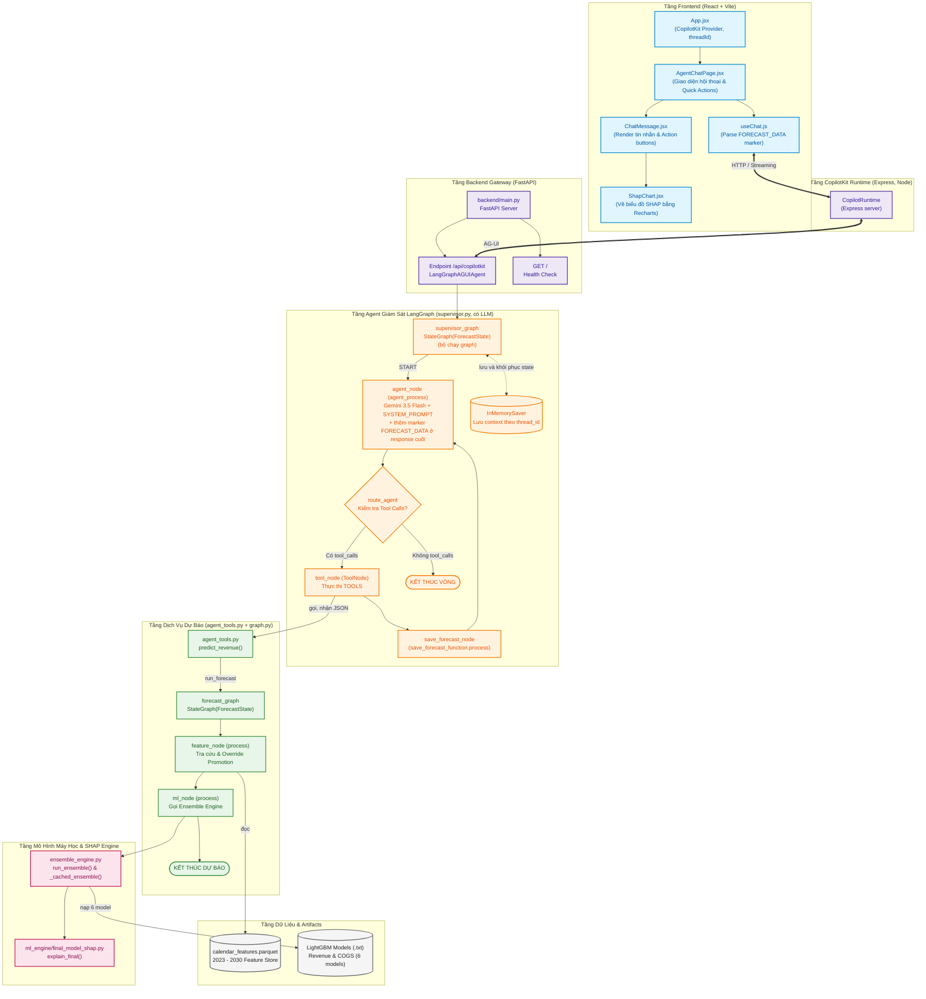
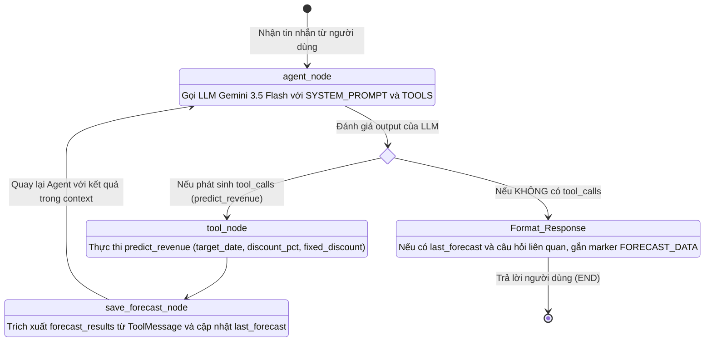
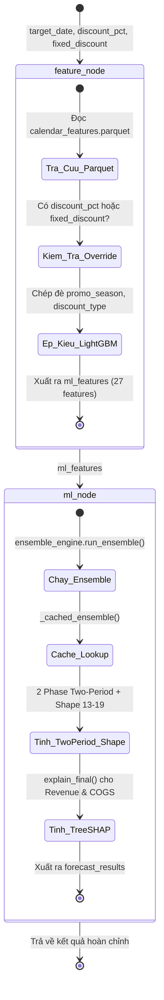
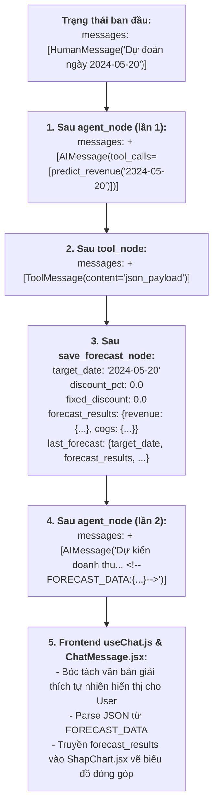
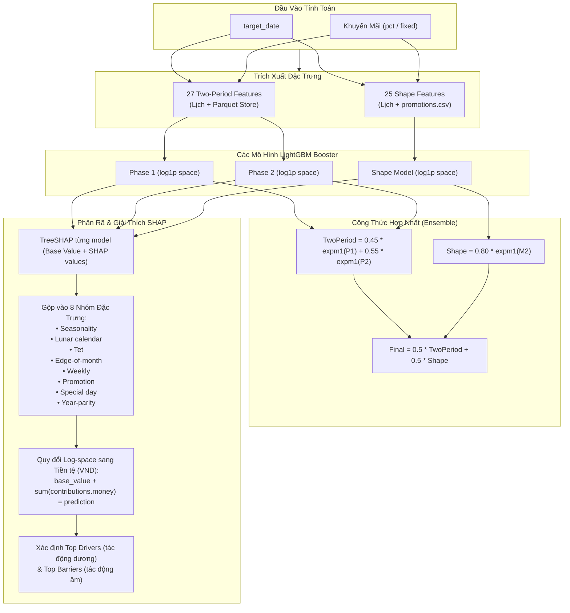

# Code Graph: Kiến Trúc & Luồng Điều Khiển Forecast Chatbot

---

## 1. Toàn Cảnh Kiến Trúc Hệ Thống (Architecture Code Graph)

Sơ đồ thể hiện sự kết nối giữa các tầng: **Frontend (React)** ➔ **API Gateway (FastAPI)** ➔ **Supervisor Agent (LangGraph + Gemini)** ➔ **Forecast Sub-Graph** ➔ **ML Ensemble Engine** ➔ **Storage & Data Sources**.

---

## 2. Đồ Thị Trạng Thái LangGraph Chi Tiết (State Graph)

Dự án gồm **hai đồ thị LangGraph lồng nhau** (Nested / Supervisor Pattern):

### 2.1. Supervisor Graph (`backend/supervisor.py`)
Đóng vai trò điều phối viên hội thoại chính của ứng dụng:

### 2.2. Deterministic Forecast Graph (`backend/graph.py`)
Đồ thị con thuần túy xử lý thuật toán và không phụ thuộc LLM:

---

## 3. Sơ Đồ Phụ Thuộc Mã Nguồn & Lời Gọi Hàm (Call Graph)

Sơ đồ dưới đây chi tiết các lời gọi hàm từ điểm vào (Entry Point) đến các hàm tính toán lõi:

```mermaid
flowchart LR
    subgraph S1 [" main.py "]
        F_INIT["FastAPI()"]
        F_AGENT["LangGraphAGUIAgent(graph=supervisor_graph)"]
        F_EP["add_langgraph_fastapi_endpoint()"]
    end

    subgraph S2 [" supervisor.py "]
        S_AGENT["agent_process(state)"]
        S_LLM["ChatGoogleGenerativeAI.invoke()"]
        S_ROUTE["route_agent(state)"]
        S_MARKER["_forecast_marker(forecast)"]
        S_CTX["_format_forecast_context()"]
    end

    subgraph S3 [" agent_tools.py "]
        T_NORM["_normalize_date(value)"]
        T_PRED["predict_revenue(target_date, ...)"]
    end

    subgraph S4 [" graph.py "]
        G_RUN["run_forecast(target_date, ...)"]
        G_INVOKE["forecast_graph.invoke()"]
    end

    subgraph S5 [" nodes/ "]
        N_FEAT["feature_node.process(state)"]
        N_ML["ml_node.process(state)"]
        N_SAVE["save_forecast_function.process(state)"]
    end

    subgraph S6 [" ensemble_engine.py "]
        E_RUN["run_ensemble()"]
        E_CACHE["_cached_ensemble()"]
        E_TP_FRAME["_two_period_frame()"]
        E_SH_FRAME["_shape_frame()"]
        E_FACTORS["_top_factors()"]
    end

    subgraph S7 [" ml_engine/ "]
        M_SHAPE["features_shape_13_19.build_features()"]
        M_SHAP["final_model_shap.explain_final()"]
        M_ONEROW["final_model_shap.shap_one_row()"]
    end

    %% Connections
    F_AGENT --> S_AGENT
    S_AGENT --> S_LLM
    S_AGENT --> S_ROUTE
    S_AGENT --> S_MARKER
    S_AGENT --> S_CTX

    S_ROUTE --> T_PRED
    T_PRED --> T_NORM
    T_PRED --> G_RUN
    G_RUN --> G_INVOKE

    G_INVOKE --> N_FEAT
    N_FEAT --> N_ML
    N_ML --> E_RUN
    T_PRED --> N_SAVE

    E_RUN --> E_CACHE
    E_CACHE --> E_TP_FRAME
    E_CACHE --> E_SH_FRAME
    E_CACHE --> E_FACTORS
    E_SH_FRAME --> M_SHAPE
    E_CACHE --> M_SHAP
    M_SHAP --> M_ONEROW
```

---

## 4. Sơ Đồ Biến Đổi Dữ Liệu (State & Data Flow Graph)

Trạng thái `ForecastState` được định nghĩa tại `backend/nodes/state.py` và biến đổi tuần tự qua các node:

---

## 5. Sơ Đồ Thuật Toán Ensemble & SHAP Trees (ML Explainer Graph)

Mô hình dự báo sử dụng kiến trúc kết hợp **Two-Period** (Phase 1 & Phase 2) cùng **Shape Model** để tối ưu hóa độ chính xác:

---

## 6. Bảng Tra Cứu Toàn Bộ Thành Phần Mã Nguồn (Symbol & File Map)

| Module / Lớp | Đường dẫn tệp | Ký hiệu / Hàm trọng tâm | Trách nhiệm |
|---|---|---|---|
| **API Entry** | [`backend/main.py`](file:///c:/Research%20Dataset/forecast-chatbot/backend/main.py) | `app`, `agent`, `/api/copilotkit` | Khởi tạo FastAPI server và tích hợp CopilotKit endpoint |
| **Supervisor** | [`backend/supervisor.py`](file:///c:/Research%20Dataset/forecast-chatbot/backend/supervisor.py) | `supervisor_graph`, `agent_process`, `route_agent` | Quản lý hội thoại, quyết định QA, gọi tool hoặc giải thích |
| **Agent Tools** | [`backend/agent_tools.py`](file:///c:/Research%20Dataset/forecast-chatbot/backend/agent_tools.py) | `predict_revenue`, `_normalize_date` | Chuẩn hóa định dạng ngày và gọi Forecast Pipeline |
| **Forecast Pipeline** | [`backend/graph.py`](file:///c:/Research%20Dataset/forecast-chatbot/backend/graph.py) | `forecast_graph`, `run_forecast` | Chuỗi node tất định (deterministic) từ feature đến ML |
| **State Definition** | [`backend/nodes/state.py`](file:///c:/Research%20Dataset/forecast-chatbot/backend/nodes/state.py) | `ForecastState` | Schema lưu trữ tin nhắn, tham số và kết quả dự báo |
| **Feature Node** | [`backend/nodes/feature_node.py`](file:///c:/Research%20Dataset/forecast-chatbot/backend/nodes/feature_node.py) | `process` | Tra cứu Parquet O(1), override khuyến mãi, chuẩn bị 27 features |
| **ML Node** | [`backend/nodes/ml_node.py`](file:///c:/Research%20Dataset/forecast-chatbot/backend/nodes/ml_node.py) | `process` | Đóng gói đầu vào và gọi bộ máy ensemble |
| **Save Memory** | [`backend/save_forecast_function.py`](file:///c:/Research%20Dataset/forecast-chatbot/backend/save_forecast_function.py) | `process` | Lưu `last_forecast` vào conversation checkpoint memory |
| **Ensemble Engine** | [`backend/ensemble_engine.py`](file:///c:/Research%20Dataset/forecast-chatbot/backend/ensemble_engine.py) | `run_ensemble`, `_cached_ensemble` | Tải 6 mô hình LightGBM, caching và tổng hợp kết quả |
| **Shape Features** | [`backend/ml_engine/features_shape_13_19.py`](file:///c:/Research%20Dataset/forecast-chatbot/backend/ml_engine/features_shape_13_19.py) | `build_features` | Tạo 25 đặc trưng Shape (Tết, âm lịch, khuyến mãi CSV) |
| **SHAP Explainer** | [`backend/ml_engine/final_model_shap.py`](file:///c:/Research%20Dataset/forecast-chatbot/backend/ml_engine/final_model_shap.py) | `explain_final`, `shap_one_row`, `GROUPS` | TreeSHAP, phân rã 8 nhóm và quy đổi đóng góp sang tiền tệ |
| **UI Chat Page** | [`frontend/src/pages/AgentChatPage.jsx`](file:///c:/Research%20Dataset/forecast-chatbot/frontend/src/pages/AgentChatPage.jsx) | `AgentChatPage`, `handleQuickAction` | Khung chat, xử lý nút bấm gợi ý và gửi prompt |
| **UI Hook** | [`frontend/src/hooks/useChat.js`](file:///c:/Research%20Dataset/forecast-chatbot/frontend/src/hooks/useChat.js) | `useChat`, `FORECAST_DATA_PATTERN` | Kết nối CopilotKit, bóc tách `FORECAST_DATA` marker |
| **UI Message** | [`frontend/src/components/ChatMessage.jsx`](file:///c:/Research%20Dataset/forecast-chatbot/frontend/src/components/ChatMessage.jsx) | `ChatMessage` | Hiển thị bong bóng chat Markdown và biểu đồ tương ứng |
| **UI SHAP Chart** | [`frontend/src/components/ShapChart.jsx`](file:///c:/Research%20Dataset/forecast-chatbot/frontend/src/components/ShapChart.jsx) | `ShapChart` | Trực quan hóa giá trị cơ sở và các nhóm tác động bằng Recharts |
