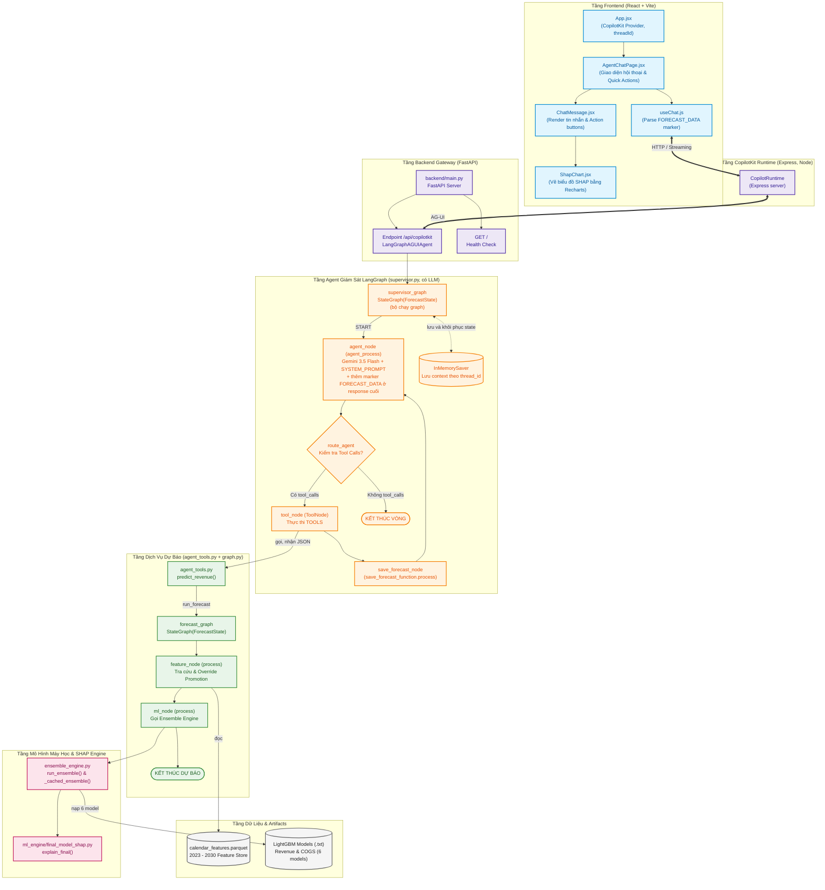
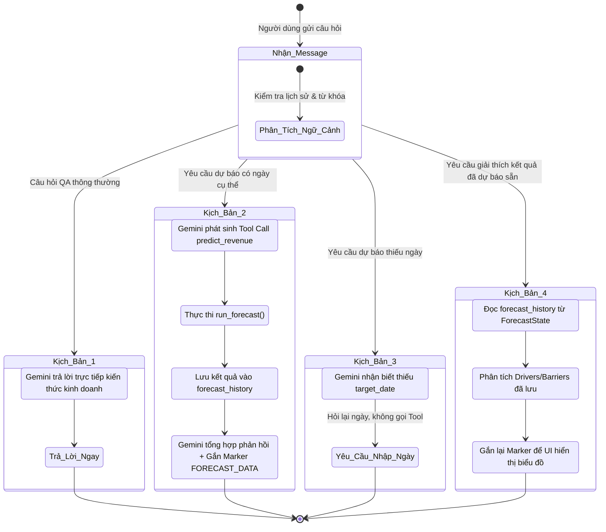
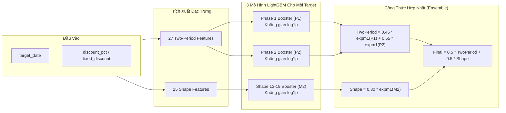

# BÁO CÁO TỔNG HỢP KIẾN TRÚC & KỸ THUẬT DỰ ÁN FORECAST CHATBOT
**Hệ Thống Trợ Lý AI Dự Báo Doanh Thu & Giá Vốn Hàng Bán (COGS) Ứng Dụng Mô Hình Lai Ensemble LightGBM và Giải Thích XAI (TreeSHAP)**

---

## 1. TỔNG QUAN DỰ ÁN

### 1.1. Bối cảnh & Mục tiêu bài toán
Trong quản trị doanh nghiệp bán lẻ và thương mại, việc dự báo chính xác **Doanh thu (Revenue)** và **Giá vốn hàng bán (COGS - Cost of Goods Sold)** đóng vai trò sống còn trong việc lập kế hoạch dòng tiền, quản lý tồn kho và tối ưu hóa các chiến dịch khuyến mại (Promotion).

Tuy nhiên, các mô hình học máy truyền thống thường gặp hai rào cản lớn:
1. **Tính chất "Hộp đen" (Black-box):** Người ra quyết định không hiểu tại sao doanh thu của một ngày cụ thể lại tăng đột biến hay sụt giảm, dẫn đến sự thiếu tin tưởng vào kết quả dự báo.
2. **Khả năng tương tác hạn chế:** Báo cáo tĩnh hoặc dashboard BI không giải quyết được các câu hỏi phát sinh theo ngữ cảnh tự nhiên (ví dụ: *"Tại sao ngày 10/09 doanh thu lại thấp thế?", "Nếu áp dụng giảm giá 20% thì doanh thu và chi phí sẽ thay đổi ra sao?"*).

**Forecast Chatbot** được xây dựng nhằm giải quyết triệt để hai rào cản trên bằng cách kết hợp:
* **Mô hình học máy lai chính xác cao (Ensemble LightGBM):** Kết hợp giữa mô hình chuỗi thời gian lịch Two-Period và mô hình định hình phân phối theo chu kỳ Shape Model.
* **Hệ thống giải thích XAI (Explainable AI - TreeSHAP):** Bóc tách định lượng đóng góp của từng nhóm yếu tố và quy đổi trực tiếp ra giá trị tiền tệ thực tế ($\text{VND}$).
* **Kiến trúc Agent đàm thoại thông minh (LangGraph + Google Gemini 3.8 Flash):** Điều phối hội thoại tự nhiên, hiểu ngữ cảnh lịch sử, tự động nhận biết intent, hỏi lại khi thiếu dữ kiện và chỉ kích hoạt pipeline tính toán khi cần thiết.
* **Giao diện người dùng thời gian thực (React + CopilotKit + AG-UI):** Hỗ trợ phản hồi dạng streaming qua SSE và trực quan hóa các động lực/rào cản tài chính bằng biểu đồ trực quan.

---

## 2. TOÀN CẢNH KIẾN TRÚC HỆ THỐNG (SYSTEM ARCHITECTURE)

Hệ thống được thiết kế theo kiến trúc phân tầng chuyên biệt, tách bạch hoàn toàn giữa **Tầng đàm thoại / điều phối thông minh (Non-deterministic)** và **Tầng tính toán dự báo tất định (Deterministic ML Pipeline)**.



---

## 3. THIẾT KẾ ĐỒ THỊ TRẠNG THÁI LANGGRAPH & LUỒNG ĐIỀU PHỐI (AGENT ORCHESTRATION)

Dự án áp dụng mẫu thiết kế **Nested StateGraph** (Đồ thị lồng nhau) để phân tách rõ trách nhiệm:
1. **Supervisor Graph (`backend/agent/supervisor.py`):** Xử lý giao tiếp, phân loại intent và tương tác LLM.
2. **Forecast Graph (`backend/pipelines/forecast_graph.py`):** Thực thi chuỗi xử lý số học thuần túy, đảm bảo tính tất định (deterministic), không phụ thuộc vào LLM.

### 3.1. Phân loại Intent & 4 Kịch bản Hội thoại Chính



#### Phân tích chi tiết từng kịch bản:

* **Kịch bản 1: Hỏi đáp nghiệp vụ (QA thông thường):**
  * *Ví dụ:* "COGS là gì?", "Biên lợi nhuận gộp tính thế nào?"
  * *Xử lý:* `SYSTEM_PROMPT` quy định rõ không gọi tool khi không có yêu cầu dự báo. Gemini sinh câu trả lời trực tiếp. `route_agent` nhận thấy không có `tool_calls` nên điều hướng thẳng về `END`. Pipeline ML không bị kích hoạt lãng phí.
* **Kịch bản 2: Dự báo doanh thu với ngày cụ thể:**
  * *Ví dụ:* "Dự đoán doanh thu ngày 20/11/2024, giảm giá 15%".
  * *Xử lý:* Gemini phát sinh tool call `predict_revenue(target_date="2024-11-20", discount_pct=15.0)`.
  * `ToolNode` kích hoạt `run_forecast()`, đẩy qua `feature_node` và `ml_node`.
  * Sau khi có kết quả JSON, `save_forecast_node` cập nhật dữ liệu vào `forecast_history`.
  * Supervisor gọi lại `agent_node` lần 2. Gemini chuyển hóa dữ liệu số học thành văn bản tự nhiên, đồng thời hệ thống tự động gắn marker ẩn `<!--FORECAST_DATA:{...}-->` ở cuối tin nhắn.
* **Kịch bản 3: Dự báo nhưng thiếu ngày:**
  * *Ví dụ:* "Hãy dự đoán doanh thu cho tôi", "Dự báo tuần này thế nào?"
  * *Xử lý:* `SYSTEM_PROMPT` quy định nghiêm ngặt: nếu thiếu ngày cụ thể, không được tự ý gọi tool và không được bịa đặt ngày. Agent sẽ phản hồi bằng một câu hỏi lịch sự yêu cầu người dùng cung cấp ngày chính xác (định dạng `YYYY-MM-DD` hoặc `DD/MM/YYYY`).
* **Kịch bản 4: Yêu cầu giải thích kết quả vừa rồi:**
  * *Ví dụ:* "Giải thích kết quả vừa rồi", "Tại sao doanh thu lại đạt mức đó?"
  * *Xử lý:* Đây là tính năng đột phá về **tính bảo toàn trạng thái (Idempotency)**. Hệ thống nhận diện từ khóa giải thích (`EXPLANATION_WORDS`), kiểm tra `forecast_history` trong `ForecastState`. Nếu đã có dữ liệu, Agent sử dụng ngay bản tóm tắt các nhân tố chính (Top Drivers, Top Barriers) đã lưu trong state để giải thích, **tuyệt đối không gọi lại tool `predict_revenue`**, giúp tiết kiệm tài nguyên và giữ thời gian phản hồi tức thì.

### 3.2. Cấu trúc State của Hệ thống (`ForecastState`)
Tại [backend/pipelines/nodes/state.py](file:///c:/Research%20Dataset/forecast-chatbot/backend/pipelines/nodes/state.py), cấu trúc trạng thái được định nghĩa chặt chẽ bằng `TypedDict`:

```python
class ForecastState(TypedDict):
    # Lịch sử hội thoại (LangGraph/CopilotKit quản lý append qua add_messages)
    messages: Annotated[List[BaseMessage], add_messages]
    
    # Các tham số trích xuất
    target_date: Optional[str]
    discount_pct: Optional[float]
    fixed_discount: Optional[float]
    clarification_needed: Optional[str]
    is_prediction_query: Optional[bool]
    
    # Dữ liệu truyền giữa feature_node và ml_node
    ml_features: Optional[dict]
    forecast_results: Optional[dict]

    # Lưu trữ kết quả các lần dự báo trong phiên làm việc hiện tại
    # Cấu trúc: { "YYYY-MM-DD": [ForecastPayload, ...] }
    forecast_history: dict[str, list[ForecastPayload]]
```

---

## 4. ĐỘNG CƠ HỌC MÁY (ML ENSEMBLE) & GIẢI THÍCH MÔ HÌNH (TREE-SHAP)

Điểm cốt lõi của năng lực dự báo trong dự án nằm tại module `backend/ml_engine/`.

### 4.1. Kiến trúc Ensemble 2 Tầng (Two-Period & Shape Model)

Dự báo cả Doanh thu (Revenue) và Giá vốn (COGS) được thực thi độc lập thông qua **6 mô hình LightGBM Booster** (`.txt`):
* Revenue: `model_rev_phase1.txt`, `model_rev_phase2.txt`, `revenue_model_shape_13_19.txt`.
* COGS: `model_cogs_phase1.txt`, `model_cogs_phase2.txt`, `cogs_model_shape_13_19.txt`.



#### Công thức toán học:
1. **Two-Period Model:**
   $$\text{TwoPeriod} = 0.45 \times \text{expm1}(P_1) + 0.55 \times \text{expm1}(P_2)$$
   *Trong đó $P_1, P_2$ là dự báo log-space từ hai phase huấn luyện thời gian khác nhau.*
2. **Shape Model:**
   $$\text{Shape} = K_{\text{target}} \times \text{expm1}(M_2) \quad (\text{với } K_{\text{Revenue}} = 0.80, K_{\text{COGS}} = 0.80)$$
3. **Mô hình kết hợp cuối cùng (Final Ensemble):**
   $$\text{Prediction}_{\text{Final}} = 0.5 \times \text{TwoPeriod} + 0.5 \times \text{Shape}$$

### 4.2. Cơ chế Giải thích XAI với TreeSHAP & Quy Đổi Tiền Tệ Chặt Chẽ

Một thách thức lớn của việc áp dụng SHAP cho mô hình Ensemble phi tuyến tính và có phép biến đổi `expm1` (từ log-space về không gian thực) là **tính chất cộng dồn (additivity)** bị phá vỡ nếu cộng trực tiếp ở không gian thực.

Dự án đã giải quyết bài toán này trong [backend/ml_engine/final_model_shap.py](file:///c:/Research%20Dataset/forecast-chatbot/backend/ml_engine/final_model_shap.py) bằng thuật toán quy đổi tỷ lệ co giãn tuyến tính chính xác:

1. **Tính SHAP riêng lẻ từng mô hình trong không gian log:**
   Sử dụng cơ chế `pred_contrib=True` tích hợp sẵn của LightGBM Booster để đạt tốc độ cao:
   $$\text{Base}_{\text{log}} + \sum \text{SHAP}_{\text{feature}} = \text{Log\_Prediction}$$
2. **Hợp nhất SHAP Two-Period & Shape:**
   $$\text{SHAP}_{\text{TwoPeriod}} = 0.45 \cdot \text{SHAP}_{P1} + 0.55 \cdot \text{SHAP}_{P2}$$
   $$\text{SHAP}_{\text{Final}} = 0.5 \cdot \text{SHAP}_{\text{TwoPeriod}} + 0.5 \cdot \text{SHAP}_{\text{Shape}}$$
   *(Các feature trùng khái niệm như `promo_count_active` và `promo_n`, hay chuỗi Fourier biến đổi sóng đều được đổi tên chuẩn hóa để cộng dồn).*
3. **Chuyển dịch cửa sổ Tết (Tet Window):**
   Cửa sổ Tết được xác định trong khoảng `[-30, 32]` ngày so với mồng 1 Tết âm lịch. Các ngày nằm ngoài cửa sổ này sẽ được tự động chuyển từ nhóm `Tet` sang nhóm `Lunar calendar`.
4. **Quy đổi ra giá trị tiền tệ thực tế ($\text{VND}$):**
   Hệ thống tính mức nền tiền tệ $\text{Base Value} = \text{expm1}(\text{Base}_{\text{log}})$ và hệ số scale:
   $$\text{scale} = \frac{\text{Prediction}_{\text{Final}} - \text{Base Value}}{\sum \text{SHAP}_{\text{Final}}}$$
   Giá trị đóng góp tiền tệ của từng đặc trưng:
   $$\text{Money}_{\text{feature}} = \text{SHAP}_{\text{feature}} \times \text{scale}$$
   Nhờ đó, luôn đảm bảo đẳng thức toán học chính xác $100\%$:
   $$\text{Base Value} + \sum \text{Money}_{\text{feature}} = \text{Prediction}_{\text{Final}}$$

### 4.3. Phân Nhóm 8 Trụ Cột Đặc Trưng Kinh Doanh
Thay vì hiển thị hàng chục đặc trưng kỹ thuật phức tạp (như `fourier_year_sin_3`, `dom_reverse`), hệ thống gom nhóm thành 8 cụm yếu tố dễ hiểu đối với nhà quản trị:

| Nhóm Yếu Tố | Đặc Trưng Tiêu Biểu | Ý Nghĩa Kinh Doanh |
|---|---|---|
| **Seasonality** | Fourier harmonics, month, doy, quarter, weekofyear | Xu hướng mùa vụ trong năm, chu kỳ quý và tháng |
| **Lunar calendar** | days_to_tet (ngoài cửa sổ Tết) | Tác động của lịch âm đối với hành vi tiêu dùng |
| **Tet** | days_to_tet, tet_before, tet_after | Đỉnh mua sắm cận Tết và phục hồi sau Tết |
| **Edge-of-month** | dom, is_som, is_eom, dom_reverse, days_in_month | Hiệu ứng nhận lương đầu tháng / thắt chặt chi tiêu cuối tháng |
| **Weekly** | dow, is_weekend | Xu hướng mua sắm ngày cuối tuần so với ngày thường |
| **Promotion** | promo_active, promo_count, discount_pct, fixed_discount | Tác động kích cầu của các chương trình giảm giá |
| **Special day** | is_special_day | Các ngày lễ lớn (30/4, 1/5, Quốc khánh, Noel...) |
| **Year-parity** | is_odd_year | Hiệu ứng chu kỳ năm chẵn / năm lẻ |

---

## 5. TẦNG GIAO DIỆN & TRẢI NGHIỆM NGƯỜI DÙNG (FRONTEND & STREAMING)

### 5.1. Cơ chế Truyền Nhận Dữ Liệu Ngầm (Marker Pattern)
Để vẽ biểu đồ phân tích SHAP trên UI mà không làm ô nhiễm câu trả lời tự nhiên của chatbot và không cần gọi thêm một lượt API dư thừa:
1. Tại backend, sau khi Agent sinh câu trả lời Markdown hoàn tất, một đoạn marker đặc biệt được nối vào cuối text:
   ```html
   <!--FORECAST_DATA:{"target_date":"2024-05-20","forecast_results":{...}}-->
   ```
2. Tại frontend, hook [frontend/src/hooks/useChat.js](file:///c:/Research%20Dataset/forecast-chatbot/frontend/src/hooks/useChat.js) sử dụng biểu thức chính quy:
   ```javascript
   const FORECAST_DATA_PATTERN = /<!--FORECAST_DATA:(.*?)-->/s;
   ```
3. Hook tự động tách payload JSON để truyền dữ liệu vào component [frontend/src/components/ShapChart.jsx](file:///c:/Research%20Dataset/forecast-chatbot/frontend/src/components/ShapChart.jsx), đồng thời cắt bỏ thẻ HTML trước khi đưa đoạn văn bản thuần túy cho [frontend/src/components/ChatMessage.jsx](file:///c:/Research%20Dataset/forecast-chatbot/frontend/src/components/ChatMessage.jsx) render Markdown.

### 5.2. Biểu đồ Phân tích Trực quan ShapChart
Component `ShapChart` sử dụng thư viện **Recharts** vẽ biểu đồ cột ngang:
* **Cột màu xanh lá (`#10b981`):** Đại diện cho các nhân tố thúc đẩy tăng trưởng doanh thu (**Drivers**).
* **Cột màu đỏ (`#ef4444`):** Đại diện cho các nhân tố cản trở hoặc làm giảm doanh thu (**Barriers**).
* Hiển thị Tooltip định dạng tiền tệ Việt Nam (`Intl.NumberFormat('vi-VN', { style: 'currency', currency: 'VND' })`).

### 5.3. Trợ năng & Thao tác nhanh (Quick Actions)
* Khi mới truy cập: Nút gợi ý *"Hãy dự đoán doanh thu"*.
* Sau khi có kết quả dự báo:
  * Nút *"Dự đoán ngày khác"*: Tự động điền prompt mẫu vào ô nhập liệu và focus con trỏ chuột.
  * Nút *"Giải thích kết quả dự đoán"*: Kích hoạt nhanh câu hỏi giải thích mà người dùng không cần gõ phím.

---

## 6. BẢN ĐỒ CẤU TRÚC MÃ NGUỒN

```text
forecast-chatbot/
│
├── backend/                                # TẦNG DỊCH VỤ DỰ BÁO VÀ AGENT (Python / FastAPI)
│   ├── main.py                             # Entrypoint FastAPI, đăng ký AG-UI endpoint /api/copilotkit
│   ├── requirements.txt                    # Thư viện phụ thuộc (FastAPI, LightGBM, LangGraph, v.v.)
│   ├── render.yaml                         # Cấu hình triển khai tự động lên Render
│   ├── .env                                # Chứa GOOGLE_API_KEY (không commit lên Git)
│   │
│   ├── agent/                              # Module điều phối hội thoại Supervisor Agent
│   │   ├── supervisor.py                   # Graph chính, LLM Gemini 3.8 Flash, quản lý streaming và routing
│   │   ├── tools.py                        # Khai báo tool predict_revenue và chuẩn hóa định dạng ngày
│   │   ├── formatting.py                   # Format kết quả dự báo thành văn bản & chèn marker biểu đồ
│   │   ├── save_forecast.py                # Trích xuất ToolMessage và lưu trữ vào forecast_history
│   │   └── types.py                        # Khai báo kiểu TypedDict cho Payload dự báo
│   │
│   ├── pipelines/                          # Module thực thi quy trình dự báo (Deterministic Pipeline)
│   │   ├── forecast_graph.py               # StateGraph tuần tự: feature_node -> ml_node -> END
│   │   └── nodes/                          # Các node tính toán của graph
│   │       ├── state.py                    # Khai báo ForecastState
│   │       ├── feature_node.py             # Tra cứu Parquet O(1), override khuyến mại người dùng
│   │       └── ml_node.py                  # Node gọi sang ensemble engine
│   │
│   ├── ml_engine/                          # Module thuật toán máy học và giải thích mô hình
│   │   ├── ensemble.py                     # Nạp 6 model LightGBM, cơ chế LRU cache 100 truy vấn
│   │   ├── final_model_shap.py             # Thuật toán TreeSHAP, chuyển vị Tết và quy đổi VND
│   │   ├── features_shape_13_19.py         # Trích xuất 25 đặc trưng chu kỳ cho Shape Model
│   │   ├── feature_generator.py            # Hàm sinh đặc trưng lịch và sóng điều hòa Fourier
│   │   └── explainer.py                    # Module hỗ trợ giải thích đóng góp
│   │
│   ├── data/                               # Dữ liệu tĩnh và mô hình đã huấn luyện
│   │   ├── calendar_features.parquet       # Feature Store định sẵn từ 2023 đến 2030
│   │   ├── promotions.csv                  # Dữ liệu lịch trình khuyến mại
│   │   └── models/                         # 6 file trọng số mô hình LightGBM (.txt)
│   │       ├── model_rev_phase1.txt
│   │       ├── model_rev_phase2.txt
│   │       ├── revenue_model_shape_13_19.txt
│   │       ├── model_cogs_phase1.txt
│   │       ├── model_cogs_phase2.txt
│   │       └── cogs_model_shape_13_19.txt
│   │
│   └── scripts/
│       └── generate_feature_store.py       # Script tính toán trước và tạo file calendar_features.parquet
│
├── frontend/                               # TẦNG GIAO DIỆN NGƯỜI DÙNG (React 19 / Vite / Tailwind)
│   ├── package.json                        # Thư viện phụ thuộc (CopilotKit, Recharts, Lucide, Express)
│   ├── vite.config.js                      # Cấu hình Vite & Proxy chuyển tiếp /api/copilotkit về port 4000
│   ├── server.mjs                          # Express server chạy CopilotRuntime v2 (chuyển tiếp tới backend)
│   ├── index.html                          # HTML template
│   │
│   └── src/
│       ├── main.jsx                        # Khởi chạy React DOM
│       ├── App.jsx                         # Cung cấp CopilotKit Context & sinh UUID threadId mới khi reload
│       ├── index.css                       # Cấu hình TailwindCSS
│       ├── ErrorBoundary.jsx               # Bắt lỗi crash giao diện
│       ├── pages/
│       │   └── AgentChatPage.jsx           # Màn hình chính: Chat box, Sidebar, Input bar, Header
│       ├── components/
│       │   ├── ChatMessage.jsx             # Render từng bong bóng chat, nút thao tác nhanh, nhúng biểu đồ
│       │   └── ShapChart.jsx               # Vẽ biểu đồ Recharts BarChart thể hiện Drivers / Barriers
│       └── hooks/
│           └── useChat.js                  # Tích hợp CopilotKit, bóc tách marker biểu đồ, xử lý streaming
│
├── CODE_GRAPH.md                           # Bản đồ chi tiết mối quan hệ hàm và đồ thị trạng thái
├── diagram.mmd                             # Sơ đồ Sequence Diagram của hệ thống
└── README.md                               # Sổ tay tra cứu nhanh khi bảo trì và debug
```

---

## 7. ĐÁNH GIÁ ƯU ĐIỂM, HẠN CHẾ & LỘ TRÌNH PHÁT TRIỂN

### 7.1. Các Ưu Điểm Kỹ Thuật Nổi Bật
1. **Kiến trúc phân tầng rành mạch:** Sự tách biệt giữa Supervisor Agent (LangGraph + LLM) và Forecast Graph (Deterministic ML) loại bỏ hoàn toàn hiện tượng LLM tính toán sai số học.
2. **Hiệu năng vượt trội ($O(1)$ Feature Retrieval):** Việc tính toán sẵn các đặc trưng lịch và lưu trong định dạng Parquet giúp tốc độ tạo đặc trưng chỉ mất vài mili-giây, không tiêu tốn CPU lúc người dùng chat.
3. **Giải thích XAI chuẩn mực tài chính:** Đẳng thức bảo toàn tiền tệ $\text{Base Value} + \sum \text{Contributions} = \text{Prediction}$ đem lại sự tin cậy tuyệt đối cho người dùng doanh nghiệp.
4. **Trải nghiệm Streaming mượt mà:** Ứng dụng giao thức AG-UI và CopilotKit giúp văn bản hiển thị theo thời gian thực mà không bị giật lag.

### 7.2. Hạn chế hiện tại & Hướng nâng cấp (Roadmap)
* **Bộ nhớ phiên (Session Persistence):** Hiện tại đang dùng `InMemorySaver`, phiên hội thoại sẽ bị làm mới khi người dùng F5 hoặc khi server khởi động lại.
  * *Hướng phát triển:* Tích hợp `PostgresSaver` hoặc `RedisSaver` để duy trì lịch sử hội thoại xuyên suốt nhiều phiên làm việc và hỗ trợ triển khai cụm đa máy chủ (Multi-instance load balancing).
* **Dự báo chuỗi ngày (Multi-day Range Forecast):** Hệ thống đang tập trung dự báo cho từng ngày đơn lẻ (`target_date`).
  * *Hướng phát triển:* Mở rộng tool `predict_revenue_range` để dự báo theo tuần, theo tháng hoặc theo mùa chiến dịch, đồng thời hiển thị biểu đồ đường (Line Chart) xu hướng doanh thu theo thời gian.
* **Bảo mật API:** CORS hiện tại cho phép mọi nguồn (`allow_origins=["*"]`).
  * *Hướng phát triển:* Giới hạn danh sách domain được phép gọi API trước khi đưa lên môi trường Production thực tế.
* **Xuất báo cáo tự động:** Bổ sung tính năng xuất kết quả dự báo và biểu đồ phân tích SHAP ra định dạng file PDF hoặc bảng tính Excel phục vụ trực tiếp cho các cuộc họp kinh doanh.
